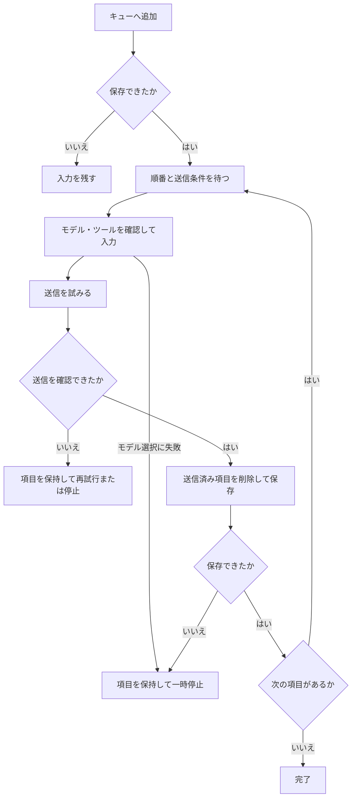
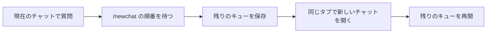
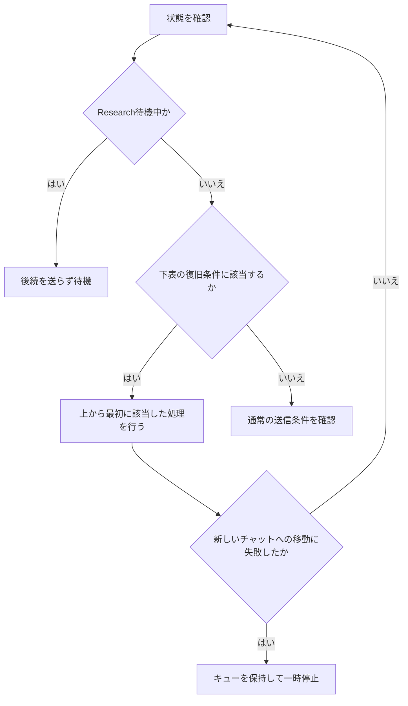

# ChatGPT Queue Assistant

ChatGPT・Geminiへ、プロンプトを順番に自動送信するChrome拡張機能です。回答を待つ間に次の質問を登録し、複数のチャットをQueue Managerで管理できます。

**Enterは通常送信、＋またはCtrl+Enterはキュー追加です。** MacではCmd+Enterを使います。

## 目次

- [導入・更新](#導入更新)
- [基本操作](#基本操作)
- [キューの動き](#キューの動き)
- [複数行・一括追加](#複数行一括追加)
- [新しいチャットへ切り替える](#新しいチャットへ切り替える)
- [コネクタ・ツール・Research・Canvas](#コネクタツールresearchcanvas)
- [Queue Managerと設定](#queue-managerと設定)
- [応答しないときの処理](#応答しないときの処理)
- [困ったときは](#困ったときは)
- [開発・検証](#開発検証)

## 導入・更新

APIキー、Node.js、ビルドは不要です。ChatGPT・Geminiには各サービスのページでログインしてください。

1. このリポジトリの「Code → Download ZIP」で取得・展開します。Gitを使う場合は次のコマンドでも取得できます。

   ```sh
   git clone https://github.com/coroke3/chatgpt-queue.git
   ```

2. Chromeで `chrome://extensions/` を開き、「デベロッパー モード」を有効にします。
3. 「パッケージ化されていない拡張機能を読み込む」で、`manifest.json` が入っているフォルダを選びます。
4. [ChatGPT](https://chatgpt.com/) または [Gemini](https://gemini.google.com/app) を開きます。すでに開いているタブは再読み込みします。

入力欄付近の＋ボタンからキューへ追加できます。拡張機能アイコンをツールバーに固定すると、ポップアップからも操作できます。

更新時は `git pull --ff-only`、または新しいZIPでファイルを更新します。その後、**拡張機能 → 対象タブ → Queue Manager** の順に再読み込みしてください。ファイルの更新だけでは開いているページに反映されません。

## 基本操作

1. ChatGPT・Geminiの入力欄に質問を書きます。
2. ＋またはCtrl+Enter／Cmd+Enterでキューに追加します。
3. 回答の終了と待機時間を待ち、先頭の項目から自動送信します。

| 操作 | ChatGPT・Geminiの入力欄 | Queue Manager・ポップアップ |
| --- | --- | --- |
| Enter | サービス本来の通常送信 | 対象タブへ通常送信 |
| Shift+Enter | 改行 | 改行 |
| ＋、Ctrl+Enter、Cmd+Enter | キューに追加 | キューに追加 |
| 一括追加ボタン | 追加画面を開く | 追加画面を開く（Queue Manager） |

一括追加画面ではEnterが改行、Ctrl+Enter／Cmd+Enterが登録です。日本語の変換確定だけでは送信・追加しません。

ChatGPTの青い標準送信ボタンによる途中介入や、生成停止はサービス本来の動作を保ちます。拡張機能が入力・送信中、または同じ入力をキューへ保存中は、重複を防ぐため手動送信を待機させます。

管理画面・ポップアップからの通常送信は、対象タブの未送信の下書きを上書きしません。送信や追加に失敗した場合も、入力を残します。

## キューの動き

通常のプロンプトは次の流れで処理します。`/newchat` は[後述の手順](#新しいチャットへ切り替える)で新しいチャットを開きます。



| 状態 | 実際の動作 |
| --- | --- |
| 一時停止・編集中・回答生成中・Researchの待機中 | 後続を送らず待機 |
| 指定したモデルを選べない | 項目を残して一時停止 |
| 思考設定を切り替えられない | 現在の設定で送信を続行 |
| コネクタ・ツールの呼び出し失敗 | エラーを記録し、元の指定を本文に残して送信を続行 |
| 送信未確認で、入力欄が送信前と同じ | その項目を1回再試行。再び未確認なら一時停止 |
| 送信未確認で、入力欄が空・別の内容に変化 | 自動再送せず、項目と入力を保持して一時停止 |
| 送信成功後の項目削除を保存できない | 一時停止。対象タブで送信結果を確認し、送信済み項目を削除してから再開 |

送信の確認には今回の本文を含む新しいユーザー発言、または入力欄が空になった後の応答開始を使います。過去の同じ質問や、空欄だけでは成功と扱いません。無効な送信ボタンを強制的に有効にすることもありません。

Queue Managerの入力は対象タブで保存完了を確認してから消します。確認待ちの連打を防ぎ、その間に書き換えた入力や、切り替え先のチャットの入力は消しません。操作先の会話が切り替わっていれば、追加・通常送信を拒否します。

**キュー稼働中の下書きに注意：** 通常入力欄の下書きが3秒間変わらないと、待機中の項目より先に自動送信します。下書きを残したい場合は、キューを一時停止してください。

### 編集・並び替え

| 操作 | 動作 |
| --- | --- |
| 編集 → 保存／キャンセル | 変更を保存／破棄。編集中は自動送信を待機 |
| 上へ・下へ | 送信順を変更 |
| 今すぐ送信 | 先頭へ移し、一時停止を解除。回答生成などの送信条件は待つ |
| 削除／クリア | 選んだ項目／待機中の全項目を削除 |
| 一時停止／再開 | 自動送信を停止／再開 |

入力・送信処理に入った項目は編集できません。編集中の入力とカーソル位置は、状態表示が更新されても保持します。

## 複数行・一括追加

| 区切り方 | 登録内容 |
| --- | --- |
| 全体を1プロンプト（初期設定） | 改行・空行・コードを含む全体を1件にする |
| 1行ごと | 空でない各行を1件にする |
| 空行で区切る | 空行で分けた文章を、それぞれ1件にする |
| `---` の行で区切る | 本文の改行・空行を保って複数件に分ける |

例えば「`---` の行で区切る」で次の文章を登録すると、2件になります。項目は先頭と末尾の空白を除いて登録します。

```text
公式資料を使って調査してください。
結論と根拠を分けてください。
---
調査結果を整理してください。
1. 結論
2. 根拠
3. 未確認の点
```

Queue Managerでは全チャットへの一括追加も可能です。一部だけ保存に失敗した場合は入力と画面を残し、同じ入力での再試行では保存を確認できたタブを除きます。

## 新しいチャットへ切り替える

`/newchat` をキューに追加すると、その順番で同じタブに新しいチャットを開き、残りの項目とモデル・ツール指定を引き継ぎます。過去の会話本文は転記しません。成功時の流れは次のとおりです。



一括追加の「1行ごと」なら、次のように登録できます。

```text
現在のテーマについて質問します
/newchat
別のテーマについて質問します
```

`/newchat 最初の質問` と1件にまとめる指定や、パネル・Queue Managerの `/newchat` ボタンも使えます。通常送信での実行は対象外なので、キューへ追加してください。

回答生成中・一時停止中・未送信の下書きがある間は切り替えを待ちます。保存や切り替えに失敗した場合は、キューを保持して停止します。

## コネクタ・ツール・Research・Canvas

プロンプトの先頭に指定を書きます。空白を含む名前はダブルクォートで囲みます。

| 指定例 | 用途 |
| --- | --- |
| `@GitHub 変更を確認して` | アプリ・コネクタ |
| `@"Google Drive" 文書を要約して` | 空白を含むアプリ名 |
| `@GitHub @"Google Drive" 仕様とコードを比較して` | 複数の指定 |
| `/"Web search" このテーマを検索して` | 対象サービスのツール |
| `/deepresearch 公開資料から調査して` | ChatGPT・GeminiのDeep Research |
| `/canvas HTMLアプリを作って` | GeminiのCanvas |

`/ディープリサーチ`、`/"Deep Research"`、`/キャンバス` も使えます。Geminiのモードは1件につき1つです。後続の項目にモード指定がなければ、通常の質問へ戻します。

Queue Managerと一括追加画面では、候補を選んでも指定文字列を残すため、そのままコピー・貼り付けできます。入力欄上の「指定を認識」は文字列を指定として読み取った表示です。利用できるかは送信時に対象サービスで確認します。指定を取り消すには、その文字列を削除します。本文中のメールアドレス・URL・コードは指定として扱いません。

アプリの接続・ログインの承認は各サービス側で済ませてください。指定が利用不可・曖昧・同時選択不可の場合や、入力中に選択が失われた場合も送信を続行します。利用できる指定は選択し、失敗があれば元の指定文字列を本文に残します。メニューにないskillsも文字列として送りますが、その機能の実行を保証するものではありません。

呼び出し失敗は対象ページの開発者ツールのコンソールと、拡張機能ストレージの `cgq_tool_errors_<タブID>` に記録します。保存するのは最新100件の日時・サービス・失敗段階・項目ID・エラーメッセージです。本文と回答は記録せず、ログ保存の失敗でも送信を続けます。

### Deep Researchの開始待ち

計画と「リサーチを開始」が表示されたら、対象タブで確認して開始してください。計画待ち・カウントダウン・開始直後も後続キューを止め、生成と回答の変化から完了を検出すると再開します。開始ボタンが消えただけでは再開せず、同じタブの再読み込み後も待機を保持します。呼び出しに失敗したResearchについては開始を待ちません。

キャンセルした場合や完了を検出できない場合は、対象タブで終了を確認してください。開始ボタンと生成中の表示がない状態で、一時停止してから再開すると待機を解除できます。

## Queue Managerと設定

ポップアップやキューパネルからQueue Managerを開けます。単一チャット／グリッド表示で、キュー操作、対象タブへの移動、検索・絞り込み、回答の表示・コピーができます。

モデル選択では対象サービスの候補を取得します。「Auto」は送信時のモデルを変更しません。思考設定も、サービス側で取得できた候補から選びます。

過去ログは上へスクロールして取得します。失敗時は「ログが取得できません」と表示します。引用は取得できたリンクを表示し、URLを推測しません。

設定では待機時間、入力速度・入力方法、タイポ再現、テーマ、文字サイズ、カード幅などを変更できます。自動テーマは、ページ内UIでは対象サービス、Queue Manager・ポップアップではOSに追従します。ダーク／ライトの固定も可能です。自動スクロールは下端付近で追従し、過去ログを読む間は止まります。

キューはタブと会話ごとに管理し、非表示タブでも処理します。ただし、Chromeがタブを休止・破棄すると処理できない場合があります。待機のためにタブを前面へ切り替えることはありません。

キュー・設定・表示用の回答は拡張機能ストレージに保存します。一時停止は同じタブの会話ごとに再読み込み後も復元します。タブを閉じた後や別タブからの自動復元は保証しません。表示用フォント、引用元のfavicon、回答内の画像・地図などは外部へ通信する場合があります。

## 応答しないときの処理

管理画面が対象タブに接続できない場合は、対象タブを開いて再読み込みしてください。コネクタ・ツール候補の取得は、6秒間応答がなければエラーを表示します。これは、対象サービス側の回答停止とは別の処理です。

対象ページが動作している間は、次の順で復旧条件を確認します。Research待機中やキュー編集中は、後続の判定を行いません。



| 判定順 | 検出した状態 | 動作 |
| --- | --- | --- |
| 1 | ChatGPTの会話の長さ上限 | 残りのキューを保存し、新しいチャットへ移動 |
| 2 | キューまたは送信記録があり、配信タイムアウト表示が出た | 再試行ボタンがあれば押して30秒待つ。改善しなければ1回再読み込み。ボタンがなければ再読み込みから開始。再読み込み後も続く場合は、送信記録のある項目を先頭へ戻し、新しいチャットへ移動 |
| 3 | 送信記録があり、回答の進展が1時間ない | 記録の項目を先頭へ戻し、新しいチャットへ移動。一時停止中はこの判定を行わない |
| 4 | ChatGPTの接続切断表示があり、自動再読み込みが有効 | 最後の回答文字数の変化から設定時間（最低2分）を待って再読み込み。文字数が変われば数え直し、切断表示が消えれば解除 |

1時間の停止判定は回答文字数とユーザー発言数の変化を進展として扱います。一時停止中も、会話上限・配信タイムアウト・接続切断の復旧判定は続けます。Research待機中はこれらの復旧条件を確認しません。

新しいチャットへの移動が15秒以内に確認できない場合も停止します。復旧時の切り替えでも、残りの項目と各項目の設定を引き継ぎ、過去の会話本文は転記しません。

## 困ったときは

| 症状 | 確認・操作 |
| --- | --- |
| ＋が出ない／更新が反映されない | 拡張機能 → 対象タブ → Queue Managerの順に再読み込み |
| キューが進まない | 一時停止、編集中、回答生成中、Research待機中、モデル選択エラーの表示を確認 |
| 送信済み項目が残っている | 対象タブで結果を確認し、その項目を削除してから再開 |
| 下書きを残しておきたい | キューを一時停止。稼働中は3秒間変わらない下書きを先に自動送信 |
| ポップアップから追加できない | ChatGPT・Geminiのタブを開き、再読み込み。入力は残る |
| モデルやツールの候補が出ない | 対象タブで利用可能か確認し、別のメニューを閉じて再取得 |

サービスの画面変更やアカウントの利用制限で、送信・選択を検出できない場合があります。不具合の報告にはサービス名、拡張機能のバージョン、再現手順、状態表示を添えてください。

## 開発・検証

導入だけなら次の操作は不要です。開発時の構成・手動確認は[開発ガイド](docs/DEVELOPMENT.md)を参照してください。

```sh
npm ci
npm run check
npm test
```

PowerShellでは `npm.cmd` を使えます。自動テストの成功と、ログイン済みサービスでの実送信確認は別です。

UI設計には[TypeUI](https://github.com/bergside/typeui)を参考にしています。
