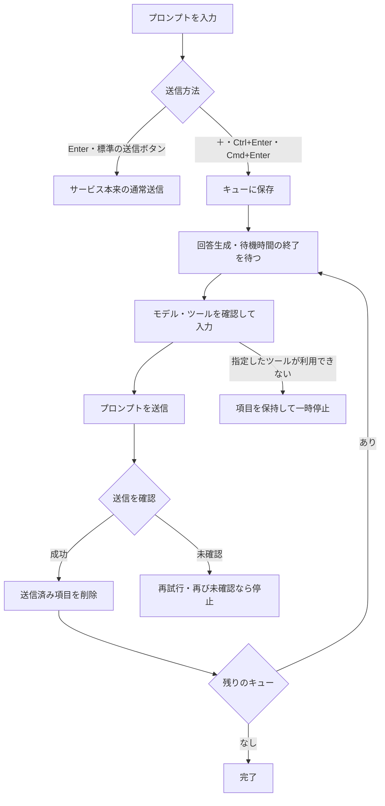
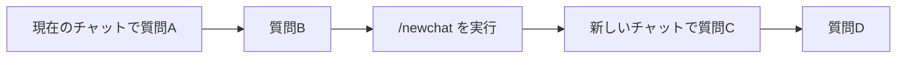

# ChatGPT Queue Assistant

ChatGPTとGeminiに、プロンプトを順番に自動送信するキュー機能を追加するChrome拡張機能です。回答を待つ間に次の質問を登録し、複数のチャットをQueue Managerでまとめて管理できます。

通常の入力欄では、Enterで通常送信、＋ボタンまたはCtrl+Enterでキューに追加します。複数行の文章、一括追加、キューの編集、新しいチャットへの切り替えに対応しています。

## 目次

- [導入方法](#導入方法)
- [基本の使い方](#基本の使い方)
- [キューを編集・管理する](#キューを編集管理する)
- [複数行のプロンプトを一括追加する](#複数行のプロンプトを一括追加する)
- [キューの途中で新しいチャットを開く](#キューの途中で新しいチャットを開く)
- [Deep Research・Canvasを使う](#deep-researchcanvasを使う)
- [アプリ・コネクタ・ツールを指定する](#アプリコネクタツールを指定する)
- [複数のチャットを管理する](#複数のチャットを管理する)
- [設定と保存データ](#設定と保存データ)
- [困ったときは](#困ったときは)
- [開発・検証](#開発検証)

## 導入方法

Chromeに、パッケージ化されていない拡張機能として読み込みます。APIキーは不要です。ChatGPT・Geminiにはそれぞれのページでログインしてください。

1. このリポジトリの「Code」→「Download ZIP」から取得し、ZIPを展開します。Gitを使う場合は、次のコマンドでも取得できます。

   ```sh
   git clone https://github.com/coroke3/chatgpt-queue.git
   ```

2. Chromeで `chrome://extensions/` を開きます。
3. 「デベロッパー モード」を有効にします。
4. 「パッケージ化されていない拡張機能を読み込む」を押し、`manifest.json` が入っているフォルダを選びます。
5. [ChatGPT](https://chatgpt.com/) または [Gemini](https://gemini.google.com/app) を開きます。すでに開いていた場合は、ページを再読み込みしてください。

入力欄付近に＋ボタンと一括追加ボタンが表示されれば、プロンプトを登録できます。拡張機能アイコンをChromeのツールバーに固定すると、ポップアップからも追加できます。

読み込むだけなら、Node.jsの導入やビルドは不要です。

### 更新する

Gitで取得した場合は `git pull --ff-only` で更新します。ZIPで取得した場合は、新しいZIPを展開して、読み込み先のファイルを更新してください。

更新後は `chrome://extensions/` で拡張機能を再読み込みし、ChatGPT・GeminiのタブとQueue Managerも再読み込みしてください。ファイルの更新だけでは、開いているページに新しいコードは反映されません。

## 基本の使い方

1. ChatGPTまたはGeminiの入力欄に、次に送りたいプロンプトを書きます。
2. 入力欄付近の＋ボタンを押します。Ctrl+Enterでも追加できます。MacではCmd+Enterを使います。
3. キューの順番を確認します。回答生成中は待機し、生成の終了と待機時間の経過後に、先頭から送信します。



キューが空になれば、自動送信を終えます。Deep Researchの計画確認が必要な場合は、後続の項目を待機させます。

### キーとボタンの使い分け

| 場所・操作 | 動作 |
| --- | --- |
| ChatGPT・Geminiの入力欄でEnter | サービス本来の通常送信 |
| ChatGPT・Geminiの入力欄でShift+Enter | 改行 |
| 入力欄付近の＋、Ctrl+Enter、Cmd+Enter | キューに追加 |
| 入力欄付近の一括追加ボタン | 複数行・複数件の追加画面を開く |
| 一括追加画面でCtrl+Enter、Cmd+Enter | 入力したプロンプトを追加 |
| Queue Managerの入力欄でEnter | 初期設定ではキューに追加。設定で変更可能 |
| 拡張機能のポップアップでEnter | キューに追加。Shift+Enterで改行 |

ChatGPTの青い標準送信ボタンは、サービスが途中介入を受け付ける状態なら、そのまま途中介入に使えます。生成停止ボタンもサービス本来の動作を保ちます。拡張機能がキュー項目を入力・送信している間は、二重送信を防ぐため手動送信を待機させます。

キューに送信待ちの項目があり、通常入力欄に下書きが残っている場合は、下書きが3秒間変化しなくなると、その下書きを先に自動送信します。下書きを書き続けたい場合は、キューを一時停止してください。

## キューを編集・管理する

対象タブのキューパネルを展開すると、項目ごとに操作できます。

| 操作 | 動作 |
| --- | --- |
| 編集 → 保存 | プロンプトを変更。編集中は自動送信を待機 |
| 編集 → キャンセル | 変更を破棄して編集を終了 |
| 上へ・下へ | 送信順を変更 |
| 今すぐ送信 | 対象項目を先頭に移し、一時停止を解除して送信処理を開始 |
| 削除 | 対象項目をキューから削除 |
| 一時停止・再開 | 自動送信を停止・再開 |
| クリア | 待機中のキューを削除 |

「今すぐ送信」でも、進行中の回答を中断して割り込むことはしません。回答の終了など、送信条件が整うまで待ちます。すでに入力・送信処理に入った項目は編集できません。

編集中は、状態表示が更新されても入力内容とカーソル位置を保持します。追加・編集・削除・並び替えの保存処理は順番に実行し、通常入力欄・一括追加・ポップアップからの追加が保存に失敗した場合は、入力を残します。

## 複数行のプロンプトを一括追加する

一括追加画面では区切り方を選んで登録します。

| 区切り方 | 登録される内容 |
| --- | --- |
| 全体を1プロンプト | 初期設定。改行・空行を含む入力全体を1件にする |
| 1行ごと | 空でない各行を別の項目にする |
| 空行で区切る | 空行で分けた文章を、それぞれ1件にする |
| `---` の行で区切る | 区切り行の間を1件にする。本文内の改行・空行を保持 |

文章・箇条書き・コードをまとめて送りたい場合は「全体を1プロンプト」を使います。複数行のプロンプトを複数件登録する場合は「`---` の行で区切る」を選び、次のように入力してください。

```text
次の条件で調査してください。
・公式資料を使う
・結論と根拠を分ける
---
調査結果を次の順で整理してください。
1. 結論
2. 根拠
3. 未確認の点
```

この例は2件になります。各プロンプトの前後の空白は除去します。

## キューの途中で新しいチャットを開く

`/newchat` をキューに追加すると、その順番で拡張機能が同じタブに新しいチャットを開き、残りのキューを引き継ぎます。ChatGPT・Geminiの両方に対応しています。



次の例は一括追加で「1行ごと」を選んで登録してください。

```text
現在のテーマについて質問します
/newchat
別のテーマについて質問します
```

`/newchat 最初の質問` と書けば、切り替えと最初の質問を1件にまとめられます。パネルやQueue Managerの `/newchat` ボタンからも追加でき、並び替えで実行位置を変えられます。

回答生成中・一時停止中は切り替えません。`/newchat` の実行時に未送信の下書きがある場合は、下書きがなくなるまで待ちます。過去の会話内容は新しいチャットへ転記しません。切り替えに失敗すると、キューを保持して停止します。

ChatGPTの会話上限の警告を検出した場合も、新しいチャットへ残りのキューを引き継ぎます。本文やコードに書かれた警告文は、切り替えの対象にしません。

## Deep Research・Canvasを使う

プロンプトの先頭にモードを書き、＋またはCtrl+Enter／Cmd+Enterでキューに追加します。Queue Managerや一括追加でも同じ指定を使えます。

| 指定 | 対応サービス | 例 |
| --- | --- | --- |
| `/deepresearch` | ChatGPT・Gemini | `/deepresearch 公開資料から調査レポートを作って` |
| `/canvas` | Gemini | `/canvas 調査メモを整理するHTMLアプリを作って` |

`/ディープリサーチ`、`/"Deep Research"`、`/キャンバス` という表記も使えます。利用できるモードは対象アカウントとサービス側のメニューに従います。指定したモードを選択できない場合は、本文を送らず、項目を残して停止します。

Geminiでは、1件につき1つのモードを指定してください。送信ごとに前のモードを解除するため、後続の質問にモード指定がなければ通常の質問として送ります。

Deep Researchで計画と「リサーチを開始」が表示されたら、対象タブで計画を確認し、開始してください。計画の確認中は後続のキューを待機し、調査が終了すると処理を再開します。

## アプリ・コネクタ・ツールを指定する

プロンプトの先頭に `@アプリ名` または `/ツール名` を書きます。空白を含む名前はダブルクォートで囲んでください。対象サービスに表示される実際の名前を使います。

以下を別々の項目として登録する場合は、一括追加で「1行ごと」を選んでください。

```text
@GitHub リポジトリの変更を確認して
@"Google Drive" ドキュメントを要約して
@GitHub @"Google Drive" 関連する仕様とコードを比較して
/"Web search" このテーマを検索して
```

候補から選択した名前も一括入力では文字列として挿入します。送信時に対象タブのメニューを確認し、アプリやツールの選択を確認してから本文を入力します。本文中のメールアドレス・URL・コードは、指定として扱いません。

接続やログインの承認は、各サービス側で済ませてください。指定が利用不可・曖昧・同時選択不可の場合は、項目を残して停止します。全タブへ追加する場合も、各サービスで指定が利用できる必要があります。

## 複数のチャットを管理する

拡張機能のポップアップやキューパネルからQueue Managerを開くと、ChatGPT・Geminiのタブを一覧で管理できます。単一チャット表示とグリッド表示を切り替えられます。

- 回答と質問の履歴を表示し、回答をコピーできます。
- 引用元名と取得できたリンクを表示します。URLを取得できない場合は、リンクを推測しません。
- キューの追加・削除・並び替え・一時停止・再開と、対象タブへの移動ができます。
- チャット名やプロンプトで検索し、状態で絞り込めます。
- 一括追加の対象に全チャットを選ぶと、同じプロンプト一式を各タブに追加します。

キューはタブと会話ごとに管理します。バックグラウンドのタブでも処理を続けますが、ブラウザがタブを休止・破棄すると処理が遅れたり停止したりします。

### モデルと思考設定を選ぶ

Queue Managerの入力欄でモデル選択を開くと、対象タブのメニューから選択可能な候補を取得します。「現在の設定を使用」を選ぶと、送信時にモデルを変更しません。候補が変わった場合は「再取得」を使ってください。

指定したモデルを選べない場合は、プロンプトを保持して一時停止します。思考設定の選択肢もサービス側の表示に従います。

## 設定と保存データ

設定画面では回答後の待機時間、入力速度・入力方法、タイポ再現、テーマ、回答文字サイズ、カード幅などを変更できます。自動スクロールは下端付近にいるときに追従し、過去の会話を読んでいる間は追従を止めます。

「管理画面のEnterでキューに追加」はQueue Manager専用の設定です。ChatGPT・Geminiの通常入力欄は、設定にかかわらずEnterで通常送信します。

キュー・設定・管理画面に表示する回答データは、ブラウザの拡張機能用ストレージに保存します。一時停止状態はタブ内の会話ごとに保持し、同じタブの再読み込み後にも復元します。タブを閉じた後や、別のタブから開き直した場合の自動復元は保証しません。

拡張機能はログイン済みのページを操作して、プロンプトを各サービスへ送信します。表示用のフォント、引用元のfavicon、回答内の画像や地図などは、外部へ通信する場合があります。

## 困ったときは

| 症状 | 確認すること |
| --- | --- |
| ＋やパネルが表示されない | 拡張機能が有効か確認し、対象ページを再読み込みする |
| 更新したのに動作が変わらない | 拡張機能、対象タブ、Queue Managerの順に再読み込みする |
| キューが進まない | 一時停止・編集中・回答生成中・Research計画確認中でないか、状態表示を確認する |
| ツールやモデルを選べない | 対象タブで利用可能か確認し、別のメニューを閉じて候補を再取得する |
| ポップアップから追加できない | ChatGPTまたはGeminiのタブを開き、対象ページを再読み込みする。失敗時は入力を残す |
| 入力欄に下書きを残したい | キューを一時停止する。稼働中は、3秒間変化しない下書きを先に自動送信する |
| 送信済み項目の削除に失敗した | 対象サービスで送信結果を確認し、その項目をキューから削除してから再開する |

送信ボタンが無効な場合、拡張機能は強制的に有効化しません。サービス側の制限、接続状態、利用上限を確認してください。接続切断・配信タイムアウト・長時間応答がない状態では、自動再読み込みや新しいチャットでの復旧を試みる処理があります。

ChatGPT・Geminiの画面構成が変わると、送信や選択の検出に修正が必要になる場合があります。自動テストの成功と、各アカウントでの実動作の確認は別です。不具合を報告する際は、サービス名・拡張機能のバージョン・再現手順・状態表示を添えてください。

## 開発・検証

開発時のセットアップ、ファイル構成、テストと手動確認の手順は、[開発ガイド](docs/DEVELOPMENT.md)を参照してください。

```sh
npm ci
npm run check
npm test
```

WindowsのPowerShellでnpmの実行が制限される場合は、`npm` の代わりに `npm.cmd` を使います。

UIの設計には[TypeUI](https://github.com/bergside/typeui)を参考にしています。
